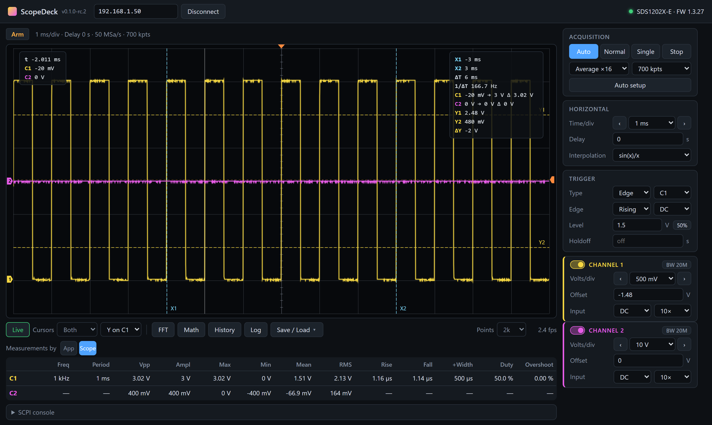

# ScopeDeck

[](https://github.com/scopedeck/scopedeck/actions/workflows/ci.yml)
[](https://github.com/scopedeck/scopedeck/releases)

A modern replacement for EasyScopeX for Siglent SDS1000X-E oscilloscopes (developed against an
SDS1202X-E, firmware 1.3.27). A .NET 10 backend talks to the scope; a TypeScript UI shows it — in its own
Windows window (`ScopeDeck.exe`) or in any browser.

No NI-VISA and no LabVIEW driver are needed: the scope accepts plain SCPI over a TCP socket on port 5025.

**[Download](https://github.com/scopedeck/scopedeck/releases)** · **[Website](https://scopedeck.github.io/scopedeck/)** · **[Roadmap](ROADMAP.md)**



## Features

- Live waveform view (≈5–20 fps over LAN depending on memory depth) with ground, trigger-position and trigger-level markers
- Controls: Auto / Normal / Single / Stop, auto setup, time/div, delay, trigger source/slope/coupling/level,
  per-channel on/off, V/div, offset, coupling, probe factor
- **Cursors**: draggable time (X1/X2) and voltage (Y1/Y2) cursors with ΔT, 1/ΔT, ΔV and each channel's value at X1/X2
- **FFT**: spectrum of any channel in dBV (RMS), Hann / Hamming / Blackman-Harris / flat-top / rectangular window,
  span zoom, peak marker, hover readout. Resolution follows the *Points* setting (20k points → finer RBW, higher Nyquist)
- **Measurements** by the app (every frame: frequency, period, Vpp, max, min, mean, RMS, duty) or by the scope
  itself (`PAVA? ALL`, full memory: adds amplitude, rise/fall time, pulse width, overshoot; refreshed every 2 s)
- **Capture memory**: the complete acquisition (up to 14 Mpts per channel) as CSV. A running scope is paused
  for the transfer (~4 s for 7 Mpts) and then resumed
- **Log**: records measurements of every frame; click again to stop and download the CSV
- Scope screenshot (PNG), CSV export of the displayed waveform, PNG export of the plot, SCPI console

## Running

**Prebuilt:** download from [Releases](https://github.com/scopedeck/scopedeck/releases) — the Windows desktop app
(`…-windows-x64-standalone.zip` needs nothing else installed) or the server + browser UI for Linux/macOS/Windows.

**Windows desktop app from source:** run `.\publish.ps1`, then start `dist\ScopeDeck.exe`. It needs the .NET 10 runtime
(use `.\publish.ps1 -SelfContained` for a ~100 MB exe that does not).

The last scope address you connected to is remembered in `%LocalAppData%\ScopeDeck\settings.json`
(`~/.local/share/ScopeDeck` on Linux, `~/Library/Application Support/ScopeDeck` on macOS). A fixed default can be set
in `appsettings.json` next to the executable (`Scope:Host`).

**Browser (any OS):**

```powershell
dotnet run --project src/Siglent.Server                      # http://localhost:5180
dotnet run --project src/Siglent.Server -- --simulate true   # with the fake scope on 127.0.0.1
```

Building the server also builds the UI (`web/`, needs Node.js 20+); pass `-p:SkipWebBuild=true` to skip it.
UI development with hot reload: run the server, then `cd web; npm run dev` and open the Vite URL.

**Linux / macOS:** everything except the desktop window is cross-platform. Run the server as above, or publish it:

```bash
dotnet publish src/Siglent.Server -c Release -r linux-x64 -p:PublishSingleFile=true -o out   # or osx-arm64, osx-x64, linux-arm64
./out/scopedeck-server     # then open http://localhost:5180
```

The server listens on localhost only. To use the app from another device, start it with
`--urls http://0.0.0.0:5180` (anyone on your network can then control the scope).

Tests: `dotnet test` (unit tests plus end-to-end tests against the simulator).

## Layout

| Path | Purpose |
| --- | --- |
| `src/Siglent.Scope` | SCPI-over-TCP client (`ScpiConnection`), typed scope API (`SiglentScope`), value parsing, waveform decoding |
| `src/Siglent.Server` | ASP.NET Core minimal API (`/api/...`); the built UI is embedded in the assembly |
| `src/Siglent.Desktop` | Windows app: WinForms window with WebView2, hosting the server in-process on a free port |
| `src/Siglent.Simulator` | `FakeScopeServer`, an SCPI-speaking fake SDS1202X-E |
| `web` | Vite + TypeScript UI (no framework) |
| `tests/Siglent.Scope.Tests` | xUnit tests |

## Protocol notes (verified on the real SDS1202X-E, FW 1.3.27)

- **One client at a time.** The scope accepts a second TCP connection but never answers it. Close EasyScopeX
  (or another ScopeDeck) before connecting.
- `CHDR OFF` is sent on connect so responses are bare values (`2.00E+00` instead of `C1:VDIV 2.00E+00V`).
  This setting persists on the scope until changed or power-cycled.
- `Cn:WF? DAT2` returns `DAT2,#9<9-digit length><bytes>\n\n`. Each byte is a **signed** 8-bit code:
  `V = code × V/div / 25 − offset`. (The guide says "subtract 255"; two's complement is correct.)
- `WFSU SP,n,NP,count,FP,0` returns exactly every n-th sample. With `NP,0` the scope ignores `SP`, so `NP` is always set.
  Decimation is plain sample skipping, so the FFT of decimated data can alias; use more points for spectra.
- **Delay sign:** `TRDL 1MS` makes the scope display "Delay: −1.00ms". The screen center is at −TRDL, so sample i
  is at `−TRDL − 7 × T/div + i × SP / SARA`. The app's *Delay* field uses the value the scope displays.
- `Cn:PAVA? ALL` returns every measurement in one response (~0.5 s); `PAVA? ALL` without a channel never answers.
  Single-parameter queries take ~0.3 s each.
- Transfers are limited by the scope: ~50–150 ms per `WF?` with 7 Mpts memory, ~4 s for the full 7 Mpts.
- `SCDP` returns an 800×480 RGB565 BMP (top-down, BI_BITFIELDS) followed by one extra `\n` byte.

## Related projects

- [klumw/sdsremote](https://github.com/klumw/sdsremote) — a Flutter app for the same scopes (VXI-11/USB) with a
  virtual front panel, macro recorder, data logger with PDF reports and an AI chat assistant.

ScopeDeck was published for one day as "SDS Remote" and renamed to avoid confusion with the project above.

## License

MIT — see [LICENSE](LICENSE). Not affiliated with or endorsed by Siglent Technologies; Siglent and EasyScopeX are trademarks of their respective owners.
